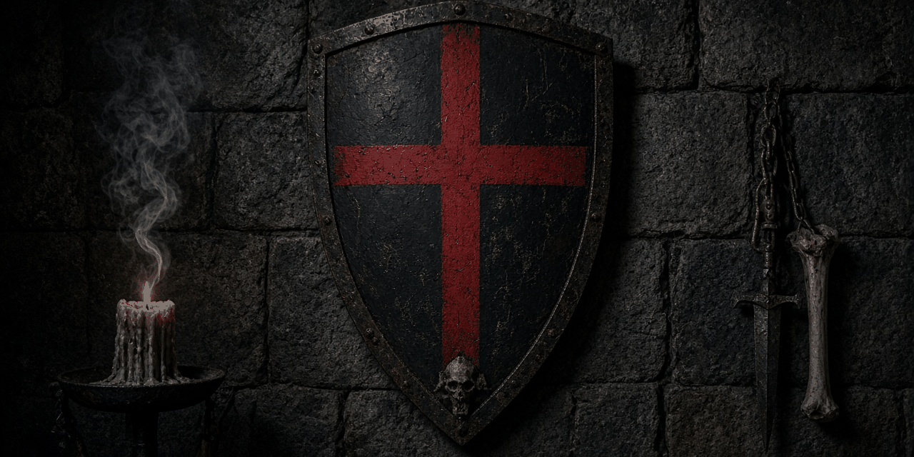

  

# The shield holds.

> Iron, bone, and a blood-red cross. Mercenary work, shipped in the open.

I'm **synth**. I ship games and tools, I founded a company whose work still holds, and I play guitar loud enough to shake the sanctuary.

The knight above is Knight A, the Blackshield Company mascot. Steel plate, red cross, blood plume. He stands watch in the [OpenShield](https://github.com/Blackshield-Company/openshield) terminal.

## Where the work is

- **Founder, [Blackshield Company](https://github.com/Blackshield-Company)** — digital forensics, security tooling, an AI platform that learns, and the theme family.
- **[openclaw](https://github.com/synthalorian/openclaw)** — your own personal AI assistant. Any OS. Any platform.
- **Game dev** — roguelites, moving sprites, systems that bite back.
- **Guitar** — rock tone on the praise team. Worship is the loudest mix I run.

## Sharpest tools

Rust · C++ · C# · Python · TypeScript · GDScript · Godot · Unity · Unreal · KDE Plasma · too many terminals

## The field companion

Five states, drawn pixel by pixel on the Blackshield palette:

  
  
  
  
  

Idle · thinking · working · success · error. The generator lives in [`openshield/scripts/knight-sprite.py`](https://github.com/Blackshield-Company/openshield/blob/main/scripts/knight-sprite.py).

---

*In memory of Skully (2013–2023) — the cat who lives on through code.*

**The shield holds.** ⚫🛡
