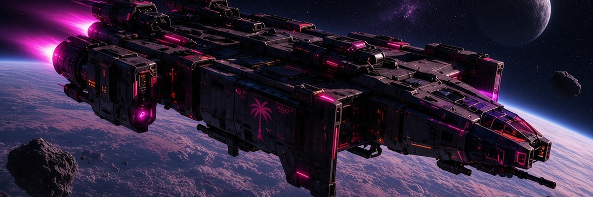
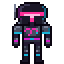

  

<h1 align="center">
  
  synthalorian
</h1>

<b><i>This is the wave.</i></b>

I'm synth. I build game engines, synths and local-first developer tools, mostly in Rust, C++, Odin and Dart. Almost all of it is open source. I live in Florida, play guitar on a praise team, and make Skyrim mods when I need a break from systems code.

I'm open to collaborators, contract work and full-time roles in game tech, audio software, AI developer tooling and security.

##  Start here

| Project | What it is |
| --- | --- |
| [**OpenShield**](https://github.com/Blackshield-Company/openshield) | An AI coding harness for the terminal, in Rust. Works with any OpenAI-compatible provider, including local servers like Ollama and llama.cpp. Persistent SQLite memory and an autonomous agent mode. |
| [**VoidEngine**](https://github.com/Blackshield-Company/voidengine) | A lightweight game engine with hot reload, in Odin and SDL2. ECS, 2D physics, audio, tilemaps, particles, OpenGL 3.3 and Vulkan. |
| [**Open Synth**](https://github.com/synthalorian/open-synth) | An open-source synthesizer built on JUCE 8 and C++20. Standalone, VST3 and CLAP. Wavetable, FM and physical-modeling oscillators, 16-part multitimbral, 5,600 presets. |
| [**wireclaw**](https://github.com/Blackshield-Company/wireclaw) | A local HTTP/HTTPS proxy that records API traffic into SQLite, with a web dashboard, a TUI, and export to OpenAPI, HAR, curl and Postman. |
| [**Open Bible**](https://github.com/synthalorian/Open-Bible) | An offline Bible study app for Android and iOS, in Flutter. 20+ translations, Strong's Concordance, reading plans. |
| [**Open Psalm**](https://github.com/synthalorian/open-psalm) | A Bible reader for your terminal, in C++20 and FTXUI. 10 translations, full-text search, cross-references, 11 color themes. |

There is a lot more than these six. The whole list, grouped, lives in the [portfolio](https://synthalorian.pages.dev).

## Find me

[Portfolio](https://synthalorian.pages.dev) · [X @thesynthalorian](https://x.com/thesynthalorian) · [Nexus Mods](https://www.nexusmods.com/profile/synthalorian) · [synth@synthalorian.com](mailto:synth@synthalorian.com)

Issues and pull requests are welcome on any repo.
